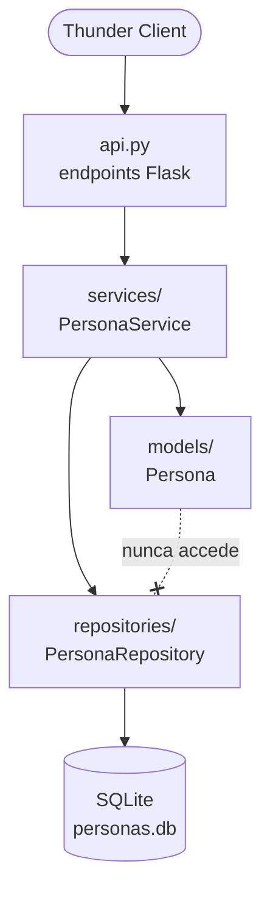

[README.md](https://github.com/user-attachments/files/33677321/README.md)# API de Personas con Flask

Trabajo práctico del bootcamp: API REST de **Persona** (DNI y nombre), organizada en capas.
Endpoints implementados: **GET** (todas / una) y **POST**.

## Reglas de negocio

- El **DNI** es un entero positivo y **no se puede repetir** (regla del servicio).
- El **nombre** empieza con mayúscula, el resto va en minúscula y **no supera los 30 caracteres** (regla del modelo).

## Requisitos

```bash
pip install flask      # o: pip install -r requirements.txt
```

## Cómo ejecutarlo

```bash
python api.py          # levanta en http://127.0.0.1:5000
```

## Estructura del proyecto



```
crud_personas/
├── api.py                          # endpoints Flask (presentación)
├── models/
│   └── persona.py                  # clase Persona + validaciones
├── repositories/
│   └── persona_repository.py       # persistencia (SQLite)
├── services/
│   ├── persona_service.py          # regla: DNI no duplicado
│   └── exceptions.py               # errores de dominio
├── requirements.txt
└── README.md
```

## Responsabilidad de cada capa

- **models**: la clase `Persona` y sus validaciones. Mantiene el objeto consistente durante todo su ciclo de vida. **El modelo nunca accede al repositorio.**
- **repositories**: guarda y busca personas en la base. Sin reglas de negocio.
- **services**: reglas que coordinan modelo y repositorio (DNI no duplicado).
- **api.py**: expone los endpoints y traduce excepciones a códigos HTTP (400, 404, 409).

## Endpoints

| Método | Ruta              | Descripción      | Respuestas    |
|--------|-------------------|------------------|---------------|
| GET    | `/personas`       | Lista todas      | 200           |
| GET    | `/personas/<dni>` | Recupera una     | 200, 404      |
| POST   | `/personas`       | Agrega una nueva | 201, 400, 409 |

Ejemplo de body para POST:

```json
{"dni": 30123456, "nombre": "Maria"}
```

## Pruebas con Thunder Client

1. `POST http://127.0.0.1:5000/personas` con body JSON válido → **201**.
2. Mismo POST otra vez (DNI repetido) → **409**.
3. POST con nombre `maria`, `MARIA` o de más de 30 caracteres → **400**.
4. `GET http://127.0.0.1:5000/personas` → **200** con la lista.
5. `GET http://127.0.0.1:5000/personas/30123456` → **200**; con un DNI inexistente → **404**.

## Cómo me gusta trabajar

> Esta sección le da contexto a la IA para no repetirlo en cada prompt.

- Código simple y legible, con nombres en español.
- Una clase/archivo por responsabilidad; capas bien separadas.
- Las validaciones van en el modelo; las reglas entre objetos, en el servicio.

